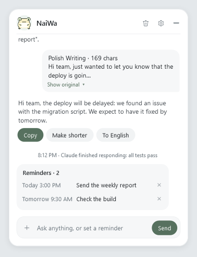
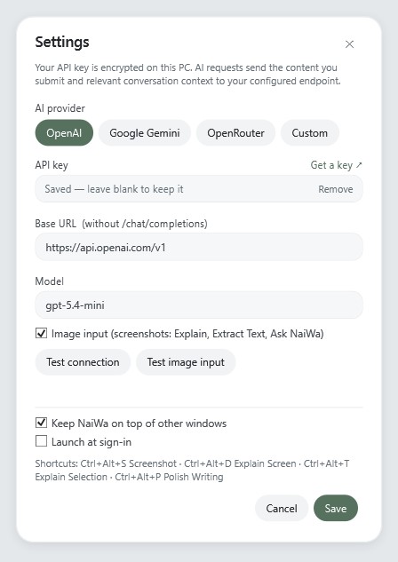

English · [简体中文](README.zh-CN.md)

<div align="center">


# NaiWa

**A tiny pixel-art frog that lives on your Windows desktop — and helps you understand, rewrite and remember things.**

*NaiWa means "milk frog" — your little desktop helper.*

Explain anything you select or screenshot · Polish your writing · Annotate screenshots · Plain-English reminders · Claude Code notifications

One ~150 KB executable · starts in about 0.1 s · bring your own API key (OpenAI, Google Gemini, OpenRouter or any OpenAI-compatible endpoint)

[Install](#install) · [Features](#features) · [Shortcuts](#shortcuts) · [Build from source](#build-from-source)

</div>

---

## Features

### Explain — selected text, a screen region, or a screenshot

| Shortcut | What it does |
|---|---|
| `Ctrl+Alt+T` | **Explain Selection** — select text in any app (an article, a contract clause, code, an error message, a term you don't know) and get a short, plain explanation |
| `Ctrl+Alt+D` | **Explain Screen** — drag over any part of the screen and NaiWa explains it right away: charts, formulas, error dialogs, UI you don't recognize |

Answers start with one sentence, add a few bullet points only when useful, and stay around 150 words. Click **Ask a follow-up** to keep going — screenshot follow-ups still see the image. Text inside a selection or a screenshot is treated as material to analyze, never as instructions.

### Polish Writing

`Ctrl+Alt+P` polishes the selected text — emails, Slack messages, reports, docs. It keeps your language, tone, facts, numbers, names, links and code exactly, and never adds anything. Then **Make shorter**, **To English**, or **Copy**.



Results **never overwrite your clipboard** until you click Copy. If NaiWa can't read your selection (some apps block it), it tells you instead of silently using whatever was on the clipboard before.

### Screenshots with annotation

`Ctrl+Alt+S` — hover to highlight a window, **click to grab the whole window**, or drag to select a region.


- **Annotate** with a pen (`P`) or highlighter (`H`), three colours each, `Ctrl+Z` to undo.
- **Copy**, **save**, or **pin** the shot on your desktop — annotations included.
- **Extract Text** copies out the exact text (layout preserved, `[unreadable]` where it can't read).
- **Explain** / **Ask NaiWa** send the shot (with your circles and highlights) to the AI. **More → Translate to English** is there when you need it.

### Reminders in plain English

Just tell NaiWa:

```
remind me in 20 minutes to stretch
remind me to call Sam tomorrow at 9am
remind me at 3:30 PM to join the standup
remind me on Friday at 2pm to submit the report
```

When it's time you get **Done** or **Snooze 10 min**. Ambiguous times get a question back ("Did you mean 3 AM or 3 PM?"), times that already passed are never silently moved, and repeating reminders are clearly declined for now instead of being half-created. Say *show my reminders* or *cancel my stretch reminder* to manage them; each one can also be cancelled from the list.

### Claude Code notifications

With a [Claude Code](https://claude.com/claude-code) Stop hook, NaiWa pops up whenever Claude finishes a reply — project name, the first line of the reply, and an **Open Claude** button. If you're already looking at Claude it's just a quiet note.


### Quiet by design

- Hides during fullscreen games and videos; anything that happens meanwhile is collected and shown once when you're back.
- The chat window is a normal window — it doesn't stay on top of your work.
- No daily greeting, no random hopping. Drag NaiWa anywhere; the right-click menu has size (small / medium / large) and *Hide to tray*.


## Install

1. Download `NaiWa.exe` from [Releases](../../releases) and put it in a folder of its own, e.g. `C:\Tools\NaiWa\` (settings are saved next to it).
2. Run it. Right-click the frog → **Settings**, pick a provider and paste your API key:

   

   | Provider | Base URL | Default model | Get a key |
   |---|---|---|---|
   | OpenAI | `https://api.openai.com/v1` | `gpt-5.4-mini` | [platform.openai.com/api-keys](https://platform.openai.com/api-keys) |
   | Google Gemini | `https://generativelanguage.googleapis.com/v1beta/openai` | `gemini-3.5-flash-lite` | [aistudio.google.com/apikey](https://aistudio.google.com/apikey) |
   | OpenRouter | `https://openrouter.ai/api/v1` | `openai/gpt-5.4-mini` | [openrouter.ai/keys](https://openrouter.ai/keys) |
   | Custom | any OpenAI-compatible endpoint (e.g. a local server) | your choice | — |

   Use **Test connection** for text and **Test image input** for screenshots (it sends a tiny built-in image and checks the answer). Screenshot features that need a vision model stay dimmed until image input is set up; copying, saving, annotating, pinning and reminders work with no key at all.
3. Tick **Launch at sign-in** if you want NaiWa to start with Windows.

Requires Windows 10 or 11 (the .NET Framework 4.8 it needs is built in).

### Connect Claude Code (optional)

Add a Stop hook to `~/.claude/settings.json` (use the real path to your `NaiWa.exe`, without spaces):

```json
{
  "hooks": {
    "Stop": [
      {
        "hooks": [
          { "type": "command", "command": "C:/Tools/NaiWa/NaiWa.exe --claude-hook", "timeout": 10, "async": true }
        ]
      }
    ]
  }
}
```

The hook process writes the start of the reply into an `inbox` folder next to the exe and exits immediately; the running NaiWa picks it up.

## Shortcuts

| Shortcut | Action |
|---|---|
| `Ctrl+Alt+S` | Screenshot |
| `Ctrl+Alt+D` | Explain Screen |
| `Ctrl+Alt+T` | Explain Selection |
| `Ctrl+Alt+P` | Polish Writing |
| `P` / `H` (in a screenshot) | Pen / highlighter |
| `Ctrl+Z` (in a screenshot) | Undo a stroke |
| `Enter` (in a screenshot) | Copy (Explain in Explain Screen mode) |
| `Esc` / right-click (in a screenshot) | Cancel / leave the drawing tool |

If another app already uses a shortcut, NaiWa tells you; every feature is also in the right-click menu.

## Privacy

- Your API key is encrypted with Windows DPAPI in `settings.json` next to the exe; only your Windows account can decrypt it.
- AI requests send the content you submit (and the relevant conversation context) to the endpoint you configured — nothing else, and nothing until you use an AI feature. OpenRouter may forward requests to its upstream providers.
- Changing the AI connection starts a new conversation, so earlier messages and screenshots are never sent to a different endpoint.
- Screenshots, annotations, copy/save/pin and reminders stay on your PC. No analytics, telemetry or auto-update.

## Build from source

No Visual Studio, no .NET SDK:

```powershell
git clone https://github.com/<you>/NaiWa.git
cd NaiWa
powershell -ExecutionPolicy Bypass -File .\build.ps1                # -> dist\NaiWa.exe
powershell -ExecutionPolicy Bypass -File .\build.ps1 -Screenshots   # also re-render docs\images
```

`build.ps1` uses `%WINDIR%\Microsoft.NET\Framework64\v4.0.30319\csc.exe` (C# 5), which every Windows 10/11 machine has. All code is in `src/NaiWa.cs`.

`-Screenshots` runs `NaiWa.exe --snapshot docs\images`, which renders the sprites, bubbles, chat window, settings, menu and toolbar to PNG offscreen — no window appears and focus isn't touched.

### Project layout

```
NaiWa/
├─ src/
│  ├─ NaiWa.cs        all source (WPF, single file)
│  └─ frames.txt      pixel art as text; the app icon is generated from it
├─ docs/images/       README images (rendered by --snapshot)
├─ build.ps1          build script
└─ .github/workflows/ CI build; pushing a v* tag publishes a release with NaiWa.exe
```

### How it works

- **Instant startup**: before WPF loads, a Win32 layered window (`UpdateLayeredWindow`) draws the frog; WPF swaps in seamlessly. With a multicore-JIT profile, cold start is about 0.1 s.
- **Window detection**: just before capture, `EnumWindows` + `DWMWA_EXTENDED_FRAME_BOUNDS` record the z-order (skipping cloaked and click-through windows) so it matches the frozen image exactly.
- **Annotations** are rendered into the capture at physical-pixel scale, so they line up on high-DPI screens.
- **AI**: one OpenAI-compatible connection, streamed over SSE; images are sent as `image_url` data URLs.

## About the character

NaiWa is an original pixel character: a pear-shaped frog with big green eyes and a little spark above its head that spins while it's thinking. The sprite data is plain text in `SpriteData` — new expressions welcome.

## License

[MIT](LICENSE)
