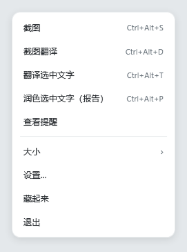

<div align="center">


# 奶蛙 NaiWa

**住在 Windows 桌面上的 Q 版像素小青蛙，也是一个顺手的效率助理。**

截图标注 · 截图取字 / 翻译 · 划词翻译与报告润色 · AI 聊天 · 自然语言提醒 · Claude Code 回复结束提醒

单个 exe，约 130 KB，启动约 0.1 秒；只用 Windows 自带的 .NET Framework 编译，不需要安装任何 SDK。

[English](#english) · [下载](#安装) · [功能](#功能) · [从源码编译](#从源码编译)

</div>

---

## 功能

### 截图：识别窗口、标注、取字、翻译

`Ctrl+Alt+S` 截图。鼠标移到哪个窗口上就高亮哪个窗口，**单击选中整个窗口**，拖动则自由框选。


- **标注**：画笔（`P`）和荧光笔（`H`），各三种颜色，`Ctrl+Z` 撤销。荧光笔是半透明的，同一笔来回涂不会越涂越深。
- **复制 / 保存 / 钉在桌面**：标注会一起画进图片。
- **提取文字**：只抄出图里的原文，保持排版。
- **翻译**：原文 + 译文（中文 ↔ 英文自动判断）。`Ctrl+Alt+D` 直接进入截图翻译模式。
- **问奶蛙**：把截图（连同你画的圈）带进对话，接着追问「这里是什么意思」时模型依然看得到这张图。

### 划词翻译与报告润色

在任何软件里选中文字：

| 快捷键 | 作用 |
|---|---|
| `Ctrl+Alt+T` | 翻译选中文字（中文 → 英文，其他 → 中文） |
| `Ctrl+Alt+P` | 润色选中文字，针对实验报告、设计说明等理工科写作：数值、单位、公式、变量名、引用编号原样保留，不补写原文没有的内容 |

结果卡片可以展开查看完整原文，下方有「复制结果」「更简洁」。**结果不会自动覆盖你的剪贴板**；取不到选中文字时会如实告诉你，而不是偷偷拿剪贴板里的旧内容去处理。


### 提醒

直接对奶蛙说「20 分钟后提醒我喝水」「下午 3 点提醒我交实验报告」。到点时奶蛙弹出通知，可以选「完成」或「10 分钟后」。提醒列表里每条都能单独取消；说「取消喝水提醒」只会取消那一条。

### Claude Code 回复结束提醒

配合 [Claude Code](https://claude.com/claude-code) 的 Stop 钩子使用：Claude 每结束一轮回复，奶蛙就弹出通知，显示项目名和回复开头，点「打开 Claude」回到 Claude 窗口。正在看 Claude 时只轻轻提示，不出声。


### 不打扰

- 全屏玩游戏、看视频时自动躲起来；期间的提醒和通知先攒着，退出全屏后合并提示一次。
- 对话窗是普通窗口，不会一直压在别的软件上。
- 不会每天开机问好，也不会随机乱跳。
- 拖动奶蛙时自动收起对话窗和气泡；右键菜单可以调大小（小 / 中 / 大）或藏到托盘。



## 安装

1. 从 [Releases](../../releases) 下载 `NaiWa.exe`，放到一个固定的文件夹里，比如 `C:\Tools\NaiWa\`。设置文件会保存在 exe 旁边。
2. 双击运行。右键奶蛙 → 设置，填入 AI 密钥：
   - **DeepSeek**（聊天、翻译、润色）：<https://platform.deepseek.com/api_keys>
   - **豆包 / 火山方舟**（看图：截图取字、截图翻译、问图）：<https://console.volcengine.com/ark>

   只填一个也能用；截图、标注、提醒不需要任何密钥。
3. 想开机自动启动，在设置里勾选「开机自动启动」。

系统要求：Windows 10 / 11（自带 .NET Framework 4.8，无需另外安装）。

### 接入 Claude Code（可选）

在 `~/.claude/settings.json` 里加一个 Stop 钩子（把路径换成你的 `NaiWa.exe` 实际位置，路径里不要有空格）：

```json
{
  "hooks": {
    "Stop": [
      {
        "hooks": [
          { "type": "command", "command": "C:/Tools/NaiWa/NaiWa.exe --claude-hook", "timeout": 10, "async": true }
        ]
      }
    ]
  }
}
```

钩子进程只把这轮回复的开头写进 exe 旁边的 `inbox` 文件夹，然后立刻退出；正在运行的奶蛙读到后弹出通知。

## 快捷键

| 快捷键 | 作用 |
|---|---|
| `Ctrl+Alt+S` | 截图 |
| `Ctrl+Alt+D` | 截图翻译 |
| `Ctrl+Alt+T` | 翻译选中文字 |
| `Ctrl+Alt+P` | 润色选中文字（报告） |
| 截图中 `P` / `H` | 画笔 / 荧光笔 |
| 截图中 `Ctrl+Z` | 撤销一笔 |
| 截图中 `Enter` | 复制（截图翻译模式下为翻译） |
| 截图中 `Esc` / 右键 | 取消 / 退出画笔 |

快捷键被其他软件占用时，奶蛙会提示，这些功能也都能从右键菜单使用。

## 隐私

- 密钥用 Windows DPAPI 加密保存在 exe 旁边的 `settings.json` 里，只有当前 Windows 用户能解开。
- 只有你主动使用 AI 功能时，相关的文字或截图才会发送给你选择的服务（DeepSeek 或火山方舟）。截图、标注、复制、保存、提醒都只在本地进行。
- 没有任何统计、遥测或自动更新。

## 从源码编译

不需要 Visual Studio，也不需要 .NET SDK：

```powershell
git clone https://github.com/<you>/NaiWa.git
cd NaiWa
powershell -ExecutionPolicy Bypass -File .\build.ps1          # 生成 dist\NaiWa.exe
powershell -ExecutionPolicy Bypass -File .\build.ps1 -Screenshots   # 顺便重新生成 docs\images 里的配图
```

`build.ps1` 调用 Windows 自带的 `%WINDIR%\Microsoft.NET\Framework64\v4.0.30319\csc.exe`（C# 5）。所有代码都在 `src/NaiWa.cs` 一个文件里。

`-Screenshots` 会运行 `NaiWa.exe --snapshot docs\images`：在屏幕外把形象、气泡、对话窗、菜单和工具栏渲染成 PNG，不会弹出窗口，也不会抢焦点。

### 项目结构

```
NaiWa/
├─ src/
│  ├─ NaiWa.cs        全部源码（WPF，单文件）
│  └─ frames.txt      像素形象的字符画，编译时生成程序图标
├─ docs/images/       README 配图（由 --snapshot 生成）
├─ build.ps1          编译脚本
└─ .github/workflows/ 自动编译；推送 v* 标签时自动发布 Release
```

### 实现要点

- **启动秒出**：WPF 加载前先用 Win32 分层窗口（`UpdateLayeredWindow`）把奶蛙画出来，WPF 准备好再无缝替换；配合多核 JIT 缓存，冷启动约 0.1 秒。
- **窗口识别**：截图前用 `EnumWindows` + `DWMWA_EXTENDED_FRAME_BOUNDS` 记下当时的窗口层叠，跳过隐身（cloaked）和鼠标穿透的窗口，和冻结的画面完全对应。
- **标注导出**：笔迹按物理像素画进截图，高 DPI 下也不会错位。
- **流式输出**：DeepSeek 与火山方舟都用 OpenAI 兼容接口，SSE 流式显示。

## 关于形象

奶蛙是原创的像素角色：梨形身体、绿白凸眼、头顶一颗会转的星芒。形象数据就是 `SpriteData` 里的字符画，欢迎在此基础上画新表情。

## 许可

[MIT](LICENSE)

---

## English

**NaiWa** is a tiny pixel-art frog that lives on your Windows desktop and doubles as a productivity helper.

- **Screenshots** (`Ctrl+Alt+S`): hover to highlight a window, click to grab it, or drag a region. Annotate with a pen or a highlighter, then copy, save, pin to the desktop, extract text, translate, or ask the AI about it (follow-up questions keep the image in context).
- **Selected text**: `Ctrl+Alt+T` translates, `Ctrl+Alt+P` polishes technical/report writing while keeping numbers, units, formulas and citations intact. Results never overwrite your clipboard unless you click *Copy*.
- **Reminders** in plain Chinese ("20 分钟后提醒我喝水"), with *Done* / *Snooze 10 min*.
- **Claude Code integration**: a Stop hook (`NaiWa.exe --claude-hook`) makes NaiWa notify you whenever Claude finishes a reply.
- **Quiet by design**: hides during fullscreen games/videos and batches notifications until you're back.

AI features use DeepSeek and/or Volcengine Ark (Doubao) with your own API keys, stored locally with Windows DPAPI. Single ~130 KB executable, ~0.1 s startup, builds with the C# compiler that ships with Windows (`build.ps1`) — no SDK required. Windows 10/11.

License: MIT.
