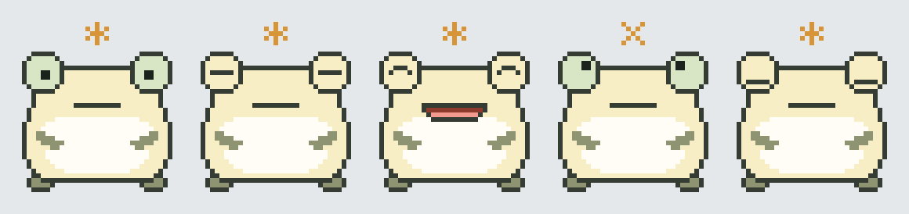
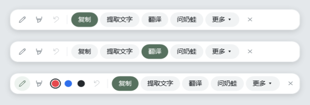
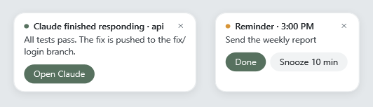

English · [简体中文](README.zh-CN.md)

<div align="center">



# NaiWa

**A cute pixel-art frog that lives on your Windows desktop — and a handy productivity assistant.**

Screenshot annotation · OCR / translate from screenshots · Select-to-translate and report polishing · AI chat · Natural-language reminders · Claude Code "reply finished" notifications

A single ~130 KB exe, starts in about 0.1 seconds; built with the .NET Framework that already ships with Windows — no SDK to install.

The app UI is in Chinese. Reminders are also given in Chinese, for example 「20 分钟后提醒我喝水」.

[Download](#install) · [Features](#features) · [Build from source](#build-from-source)

</div>

---

## Features

### Screenshots: window detection, annotation, text extraction, translation

`Ctrl+Alt+S` takes a screenshot. Hover to highlight a window, **click to capture the whole window**, or drag to select a region.



- **Annotation**: pen (`P`) and highlighter (`H`), three colors each, `Ctrl+Z` to undo. The highlighter is semi-transparent; going back over the same stroke will not make it darker.
- **Copy / save / pin to the desktop**: annotations are drawn into the image.
- **Extract text**: transcribes only the original text in the image, keeping the layout.
- **Translate**: original + translation (Chinese ↔ English, detected automatically). `Ctrl+Alt+D` goes straight into screenshot-translate mode.
- **Ask NaiWa**: brings the screenshot (including any circles you drew) into the chat; follow-up questions like "what does this mean" still have the image in context.

### Select-to-translate and report polishing

Select text in any app:

| Hotkey | Action |
|---|---|
| `Ctrl+Alt+T` | Translate the selection (Chinese → English, anything else → Chinese) |
| `Ctrl+Alt+P` | Polish the selection for lab reports, design write-ups, and other STEM writing: numbers, units, formulas, variable names, and citation numbers are left as-is; nothing is added that was not in the original |

The result card can be expanded to show the full original. Below it are 「复制结果」(Copy result) and 「更简洁」(Make it shorter). **Results never automatically overwrite your clipboard.** If the selected text cannot be read, NaiWa tells you so, instead of silently using stale clipboard content.


### Reminders

Talk to NaiWa in Chinese, for example 「20 分钟后提醒我喝水」 or 「下午 3 点提醒我交实验报告」. When the time comes, NaiWa shows a notification; you can choose 「完成」(Done) or 「10 分钟后」(Snooze 10 min). Each reminder in the list can be cancelled on its own; saying 「取消喝水提醒」 cancels only that one.

### Claude Code "reply finished" notifications

Used with the [Claude Code](https://claude.com/claude-code) Stop hook: whenever Claude finishes a reply, NaiWa shows a notification with the project name and the start of the reply. Click 「打开 Claude」(Open Claude) to return to the Claude window. If you are already looking at Claude, it only gives a light visual cue, with no sound.



### Stay out of the way

- Hides automatically during fullscreen games or videos; reminders and notifications from that period are held and delivered once when you leave fullscreen.
- The chat window is a normal window; it does not stay always-on-top over other apps.
- No daily startup greeting, and it does not hop around at random.
- Dragging NaiWa automatically dismisses the chat window and bubbles; the right-click menu can change the size (小 / 中 / 大 — small / medium / large) or hide it to the tray.


## Install

1. Download `NaiWa.exe` from [Releases](../../releases) and put it in a fixed folder, for example `C:\Tools\NaiWa\`. Settings are saved next to the exe.
2. Double-click to run. Right-click NaiWa → 设置 (Settings), and fill in your AI keys:
   - **DeepSeek** (chat, translation, polishing): <https://platform.deepseek.com/api_keys>
   - **Doubao / Volcengine Ark** (vision: screenshot OCR, screenshot translation, asking about images): <https://console.volcengine.com/ark>

   Filling in just one key still works; screenshots, annotation, and reminders need no key at all.
3. To start with Windows, check 「开机自动启动」(Start with Windows) in Settings.

System requirements: Windows 10 / 11 (ships with .NET Framework 4.8; nothing else to install).

### Claude Code integration (optional)

Add a Stop hook in `~/.claude/settings.json` (replace the path with the actual location of your `NaiWa.exe`; the path must not contain spaces):

```json
{
  "hooks": {
    "Stop": [
      {
        "hooks": [
          { "type": "command", "command": "C:/Tools/NaiWa/NaiWa.exe --claude-hook", "timeout": 10, "async": true }
        ]
      }
    ]
  }
}
```

The hook process only writes the start of that reply into an `inbox` folder next to the exe, then exits immediately; the already-running NaiWa reads it and shows a notification.

## Hotkeys

| Hotkey | Action |
|---|---|
| `Ctrl+Alt+S` | Screenshot |
| `Ctrl+Alt+D` | Screenshot translate |
| `Ctrl+Alt+T` | Translate selected text |
| `Ctrl+Alt+P` | Polish selected text (reports) |
| In screenshot: `P` / `H` | Pen / highlighter |
| In screenshot: `Ctrl+Z` | Undo last stroke |
| In screenshot: `Enter` | Copy (or translate, in screenshot-translate mode) |
| In screenshot: `Esc` / right-click | Cancel / exit the pen |

If another app is already using a hotkey, NaiWa will tell you, and all of these features are also available from the right-click menu.

## Privacy

- Keys are encrypted with Windows DPAPI and stored in `settings.json` next to the exe; only the current Windows user can decrypt them.
- Text or screenshots are sent to the service you chose (DeepSeek or Volcengine Ark) only when you actively use an AI feature. Screenshots, annotation, copy, save, and reminders all stay local.
- No analytics, telemetry, or auto-update.

## Build from source

No Visual Studio, and no .NET SDK:

```powershell
git clone https://github.com/2188037385-alt/NaiWa.git
cd NaiWa
powershell -ExecutionPolicy Bypass -File .\build.ps1          # produces dist\NaiWa.exe
powershell -ExecutionPolicy Bypass -File .\build.ps1 -Screenshots   # also regenerates the images in docs\images
```

`build.ps1` calls the C# compiler that ships with Windows: `%WINDIR%\Microsoft.NET\Framework64\v4.0.30319\csc.exe` (C# 5). All code lives in a single file, `src/NaiWa.cs`.

`-Screenshots` runs `NaiWa.exe --snapshot docs\images`: it renders the character, bubbles, chat window, menu, and toolbar to PNGs off-screen — no windows pop up, and it does not steal focus.

### Project structure

```
NaiWa/
├─ src/
│  ├─ NaiWa.cs        All source (WPF, single file)
│  └─ frames.txt      ASCII-art sprite; compiled into the app icon
├─ docs/images/       README screenshots (generated by --snapshot)
├─ build.ps1          Build script
└─ .github/workflows/ CI build; pushing a v* tag publishes a Release
```

### Implementation notes

- **Instant startup**: before WPF loads, a Win32 layered window (`UpdateLayeredWindow`) draws NaiWa first; once WPF is ready it swaps in seamlessly. Together with multi-core JIT caching, cold start is about 0.1 seconds.
- **Window detection**: before a screenshot, `EnumWindows` + `DWMWA_EXTENDED_FRAME_BOUNDS` records the then-current z-order, skipping cloaked and click-through windows, so the highlight matches the frozen frame exactly.
- **Annotation export**: strokes are drawn into the screenshot in physical pixels, so they stay aligned even on high-DPI displays.
- **Streaming**: both DeepSeek and Volcengine Ark use an OpenAI-compatible API, displayed as SSE streams.

## About the sprite

NaiWa is an original pixel character: a pear-shaped body, bulging green-and-white eyes, and a little spinning star on its head. The sprite data is the ASCII art in `SpriteData`; feel free to draw new expressions on top of it.

## License

[MIT](LICENSE)
